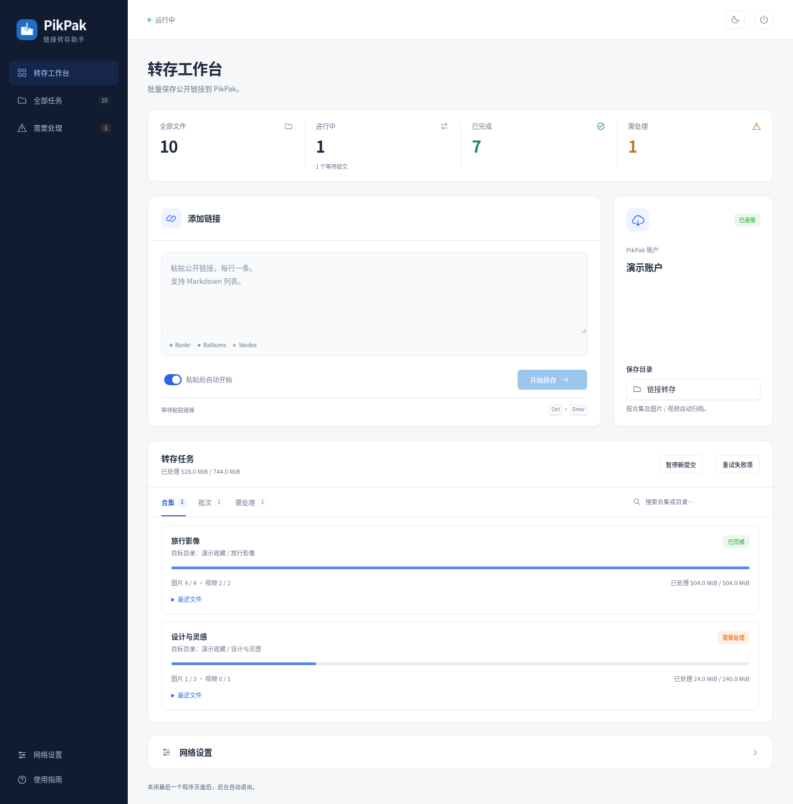

<p align="center"></p>
<h1 align="center">PikPak Link Saver</h1>
<p align="center"><strong>Save public links. Keep your PikPak organized.</strong></p>
<p align="center"><a href="README.md">简体中文</a> · English</p>
<p align="center">
  <a href="CHANGELOG.md"></a>
  
  <a href="LICENSE"></a>
</p>

A local web application for **CachyOS / Linux x86_64**. Add Bunkr albums, Balbums search pages or public Yandex links, then organize saved content by root directory, collection and image/video folders. The application interface is currently in Chinese.

- Batch input, Markdown link extraction and deduplication.
- Collection and batch views, search, pause and explicit failure retries.
- Saved authorization restored automatically, with retry on temporary network errors.
- Optional local relay and resumable transfers.
- Python standard library backend and local HTML/CSS/JavaScript frontend.
- Automatic backend shutdown after the last application page closes.

<picture>
  <source media="(prefers-color-scheme: dark)" srcset="docs/preview-dark.png">
  
</picture>

## Quick start

Install system dependencies on CachyOS:

```sh
sudo pacman -S --needed python xdg-utils curl git
```

Clone the project and install the official CLI locally:

```sh
git clone https://github.com/konijiwa286/pikpak-link-saver.git
cd pikpak-link-saver
curl -fsSL https://download.mypikpak.com/cli/install.sh | env PIKPAK_INSTALL_DIR="$PWD/bin" bash
chmod +x 启动.sh 安装桌面入口.sh
./启动.sh --self-check
./启动.sh
```

The official CLI executable is installed separately and ignored by Git. CLI **v0.5.3** has been validated with this application; the upstream installer supplies its current release. Alternatively, put `pikpak` on `PATH` or set `PIKPAK_CLI`.

Authorize your account once in the official device flow. Later launches reuse valid saved credentials. Run `./安装桌面入口.sh` to add an application menu entry.

## Data and recovery

Private task data and credentials are stored in `~/.local/share/pikpak-link-saver` by default. Set `PIKPAK_SAVER_HOME` or `PIKPAK_DIR` to select different directories. These files are kept outside the source tree and must not be committed.

Closing the last application page stops the local backend after a short grace period. Downloads already submitted to PikPak may continue in the cloud.

The detailed [usage guide](docs/USAGE.md) and [contribution guide](CONTRIBUTING.md) are currently in Chinese.

## Tests

```sh
python3 -m unittest discover -s tests -v
```

## License and credits

Project-owned source code is licensed under **GNU GPL v3.0, version 3 only**. See [LICENSE](LICENSE). Copyright (C) 2026 konijiwa286.

Third-party CSS retains its MIT notices. The official PikPak CLI is distributed separately. See [THIRD_PARTY_NOTICES.md](THIRD_PARTY_NOTICES.md).

README layout references [BewlyBewly](https://github.com/BewlyBewly/BewlyBewly). Application layout and workflow references include Tabler, Bootstrap, shadcn/ui and AriaNg.
