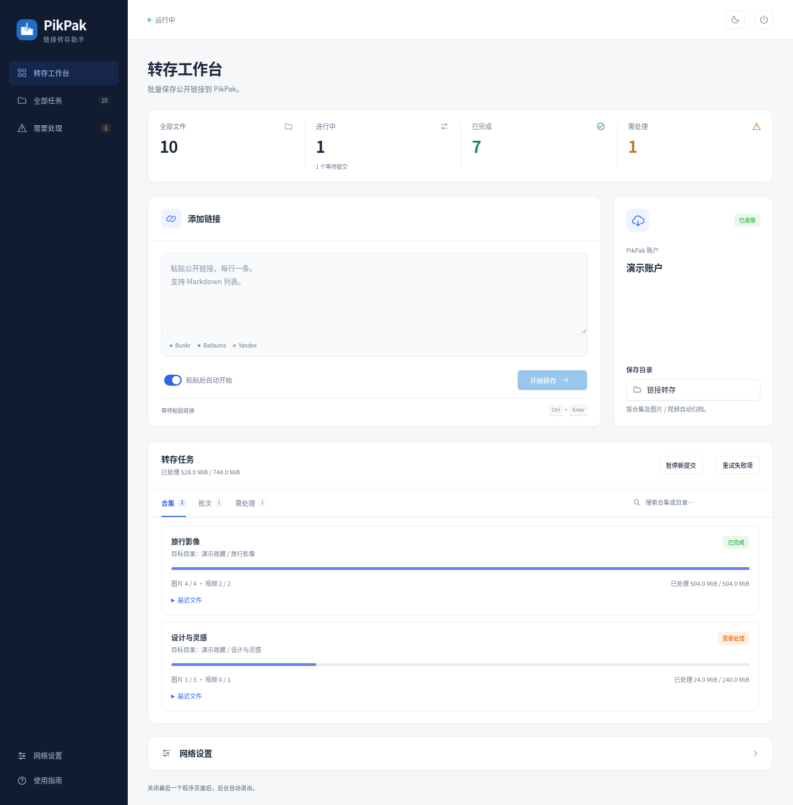

<p align="center">
  
</p>

<h1 align="center">PikPak Link Saver</h1>

<p align="center"><strong>把公开链接，整理进你的 PikPak。</strong></p>
<p align="center">批量解析 · 分类归档 · 自动恢复连接</p>

<p align="center">
  <a href="CHANGELOG.md"></a>
  <a href="#quick-start"></a>
  
  <a href="LICENSE"></a>
</p>

<p align="center">简体中文 · <a href="README.en.md">English</a></p>
<p align="center">
  <a href="#preview">界面预览</a> ·
  <a href="#quick-start">快速开始</a> ·
  <a href="docs/USAGE.md">使用指南</a> ·
  <a href="CHANGELOG.md">更新记录</a> ·
  <a href="https://github.com/konijiwa286/pikpak-link-saver/issues">反馈问题</a>
</p>

---

## 👋 介绍

PikPak Link Saver 是适用于 **CachyOS / Linux x86_64** 的本机转存工作台。粘贴 Bunkr 合集、Balbums 搜索页或 Yandex 公开链接，即可将内容保存到自己的 PikPak，并按 **根目录 → 合集 → 图片 / 视频** 归档。

后端使用 Python 标准库，界面使用本地 HTML、CSS 和原生 JavaScript。无需 Node、Electron 或前端构建，也没有运行时 CDN 依赖。

| 添加链接 | 管理任务 | 恢复连接 |
| :--- | :--- | :--- |
| 批量粘贴、Markdown 提取、自动去重 | 合集 / 批次视图、完整搜索、暂停与重试 | 复用有效授权、自动重连、核对账户身份 |

<a name="preview"></a>

## 🖼️ 界面预览

<p align="center">
  <picture>
    <source media="(prefers-color-scheme: dark)" srcset="docs/preview-dark.png">
    
  </picture>
</p>
<p align="center"><sub>演示数据 · 随 GitHub 外观显示浅色或深色预览</sub></p>

<details>
<summary>查看另一种配色</summary>

[浅色预览](docs/preview.png) · [深色预览](docs/preview-dark.png)

</details>

<a name="quick-start"></a>

## ⬇️ 快速开始

### 1. 准备环境

需要 **Linux x86_64、Python 3.8 或以上及浏览器**。在 CachyOS 安装依赖：

```sh
sudo pacman -S --needed python xdg-utils curl git
```

### 2. 获取源码并安装官方 CLI

```sh
git clone https://github.com/konijiwa286/pikpak-link-saver.git
cd pikpak-link-saver
curl -fsSL https://download.mypikpak.com/cli/install.sh | env PIKPAK_INSTALL_DIR="$PWD/bin" bash
```

PikPak CLI 由[官方安装器](https://download.mypikpak.com/cli/install.sh)另行安装，下载到本机的可执行文件已被 Git 忽略。当前应用通过 **CLI v0.5.3** 验证，官方安装器提供其当前发行版本。

<details>
<summary>已经安装过 PikPak CLI？</summary>

可以跳过安装命令。程序会依次查找项目中的 `bin/pikpak`、系统 `PATH`，也可指定路径：

```sh
PIKPAK_CLI=/path/to/pikpak ./启动.sh
```

</details>

### 3. 启动

```sh
chmod +x 启动.sh 安装桌面入口.sh
./启动.sh --self-check
./启动.sh
```

浏览器会自动打开工作台。首次使用时点击“连接 PikPak”，在官方页面确认设备码；后续启动自动复用有效授权。

### 桌面快捷方式

```sh
./安装桌面入口.sh
```

在应用菜单搜索“PikPak 链接转存助手”，可添加到桌面或任务栏。移动项目目录后，重新运行安装脚本。

## ✨ 使用流程

1. **连接账户**：首次确认授权，后续自动恢复；网络异常时自动重试。
2. **粘贴链接**：批量添加公开链接，可自动开始或按 `Ctrl + Enter` 提交。
3. **查看进度**：按合集或批次查看，失败及待核对内容集中在“需处理”。
4. **打开网盘**：在目标根目录下，按合集及图片 / 视频查看结果。

“暂停新提交”阻止新提交，已提交的云端任务仍会继续。提交结果不明时先核对远端，避免盲目重复保存。云下载失败时，可在设置中选择本机中转。

详细配置、代理、数据目录与恢复机制见 **[使用指南](docs/USAGE.md)**。

## ❓ 常见问题

<details>
<summary><strong>每次打开都要重新连接账户吗？</strong></summary>

有效授权会保存在私人数据目录，程序启动时自动恢复。暂时无法连接时会自动重试，也可点击“重试连接”；授权失效或被撤销时才需要重新授权。

</details>

<details>
<summary><strong>关掉页面后后台还会运行吗？</strong></summary>

关闭最后一个程序页面后，后台约 3 秒后开始退出。刷新和多页面有缓冲；浏览器异常退出时，通过心跳超时回收。已提交给 PikPak 的云下载可能继续在云端执行。

</details>

<details>
<summary><strong>为什么仓库里没有 PikPak CLI？</strong></summary>

这里提供转存助手源码，官方 CLI 由使用者通过官方渠道安装。它的条款与本项目许可证分开管理。

</details>

## 🤝 贡献与测试

欢迎通过 [Issues](https://github.com/konijiwa286/pikpak-link-saver/issues) 反馈问题，或提交改进。测试不需要真实账户和网络授权：

```sh
python3 -m unittest discover -s tests -v
```

贡献说明见 [CONTRIBUTING.md](CONTRIBUTING.md)。

## ❤️ 致谢

- [PikPak CLI](https://github.com/pikcloud/skills/blob/main/skills/pikpak-cli/SKILL.md)：设备授权和网盘操作。
- [Tabler](https://github.com/tabler/tabler) / [Bootstrap](https://github.com/twbs/bootstrap)：本地界面样式。
- [BewlyBewly](https://github.com/BewlyBewly/BewlyBewly)：README 信息组织与居中排版参考。
- AriaNg、shadcn/ui：任务流程和界面信息层级参考。

第三方来源与声明见 [THIRD_PARTY_NOTICES.md](THIRD_PARTY_NOTICES.md)。

## 📄 许可证

项目自有源码以 **GNU GPL v3.0（GPL-3.0-only）** 发布，完整文本见 [LICENSE](LICENSE)。

Copyright (C) 2026 konijiwa286。第三方样式保留各自的 MIT 许可，官方 PikPak CLI 由其提供方单独分发。
